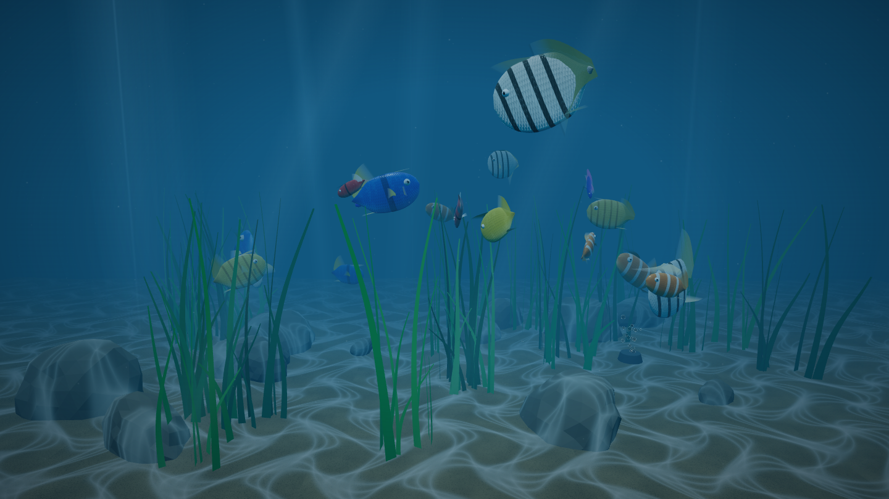

# Aquário 3D

Aquário animado em WebGL (Three.js) para usar como papel de parede vivo no
computador. Peixes com volume, escamas em relevo, nadadeiras translúcidas,
cáusticas de luz no fundo de areia e raios de sol atravessando a água.



Toda a geometria e todas as texturas são **geradas por código** — não há nenhum
arquivo de modelo, imagem ou vídeo no projeto. Roda offline.

## Sobre o realismo

Isto é 3D em tempo real, no nível de um jogo moderno: iluminação PBR, mapas de
normais, reflexo de ambiente e névoa volumétrica. **Não é fotorrealismo de
filmagem.** Nenhum motor em tempo real desenhado por código chega no nível de um
vídeo gravado de um aquário de verdade — para esse resultado o caminho é usar um
vídeo real como papel de parede, o que o Lively e o Wallpaper Engine também fazem.

## Como usar

### Só ver rodando
Abra o `aquario-3d.html` no navegador e aperte F11.

### Windows — Lively Wallpaper (gratuito)
Library → **+** → Browse → escolha o `aquario-3d.html`.

### Windows — Wallpaper Engine
Wallpaper do tipo **Web**, apontando para o `aquario-3d.html`.

### macOS — Plash
**Add Website** → **Local File** → `aquario-3d.html`.

### Linux
KDE Plasma com papel de parede HTML, ou Hidamari em modo página web.

> Use sempre o `aquario-3d.html`: ele é o arquivo único, com o Three.js e todo o
> código embutidos. O `index.html` da pasta carrega módulos separados e só
> funciona servido por HTTP, não por `file://`.

## Controles

| Tecla / ação | Efeito |
|---|---|
| **clique** | os peixes nadam até o ponto e cai ração ali |
| **arrastar** | o cardume acompanha o cursor |
| **S** | abre/fecha o painel de ajustes |
| **M** | liga/desliga o som |
| **F** | alimenta num ponto aleatório |
| **Esc** | fecha o painel |

## Som

O som de ambiente é **sintetizado em tempo real** com Web Audio: ruído marrom
filtrado em passa-baixa (o rumor grave da massa de água) mais estalos de bolha
esporádicos. **Não é uma gravação real de fundo do mar** — este projeto não
embute nenhum arquivo de áudio. Vem desligado por padrão; ligue com **M** ou pelo
painel.

Para usar um áudio real que você tenha, coloque o arquivo na pasta e troque a
chamada `Ambience.start()` em `src/50-audio.js` por um `<audio loop>` apontando
para ele. Navegadores bloqueiam áudio automático antes de qualquer clique na
página — em programas de wallpaper isso pode impedir o som de iniciar sozinho.

## Ajustes por URL

```
aquario-3d.html?fishCount=28&light=1.3&murk=0.7&quality=media&rays=0
```

| Parâmetro | Valores | Padrão |
|---|---|---|
| `fishCount` | 1 a 45 | `18` |
| `speed` | 0.2 a 2 | `1` |
| `light` | 0 a 2 | `1` |
| `murk` | 0.2 a 2 (turvação da água) | `1` |
| `quality` | `alta`, `media`, `baixa` | `alta` |
| `som` | `0` / `1` | `0` |
| `rays` | `0` / `1` | `1` |

## Desempenho

A animação **pausa quando a janela não está visível**. Em notebook, use
`quality=media` ou `baixa` — a opção baixa desliga as partículas em suspensão,
reduz os raios de sol e limita a resolução interna.

## Estrutura

```
aquario-3d.html         ARQUIVO ÚNICO — é este que se usa como wallpaper
aquario-3d.artifact.html  mesma coisa, sem as tags de documento
index.html              página de desenvolvimento (carrega src/ por HTTP)
build.js                junta vendor/ + src/ no arquivo único
vendor/three.module.js  Three.js r169 (MIT)
src/00-util.js          constantes, configuração, ruído
src/10-textures.js      texturas geradas: areia, pele, nadadeira, escamas
src/20-scene.js         água, luz, cáusticas, chão, pedras, plantas, raios
src/30-fish.js          espécies, geometria do corpo, natação, cardume
src/40-particles.js     bolhas, ração, partículas, ponto tocado
src/50-audio.js         ambiência sintetizada
src/60-main.js          interação, painel, laço de render
```

Para reconstruir o arquivo único depois de mexer em `src/`: `node build.js`

## Licença de terceiros

Three.js r169 — licença MIT, dos autores do Three.js.
