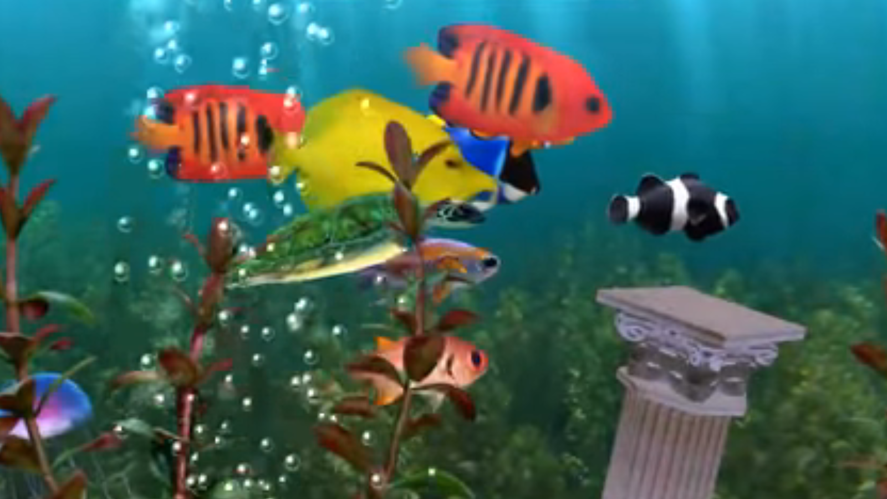

# Aquário — papel de parede em vídeo

Papel de parede animado feito a partir da gravação do **Aquarium Live Wallpaper**
(Kittehface Software). É a filmagem real do app, não uma recriação: os peixes são
os do próprio aplicativo.



## O que este player resolve

O arquivo de origem é uma gravação de tela de celular Android, e vinha com três
problemas que impediam o uso direto como papel de parede:

| Problema no arquivo original | Como foi resolvido |
|---|---|
| Barra de status do Android no topo (linhas 0–24) | recortada |
| Barra de navegação do Android à direita (colunas 598+) | recortada |
| Botões do app: *Bubbler* e *Overhead Light* (linhas 30–71) e *Props / Background / Fish* (linhas 313+) | recortados |
| Menus abrindo por cima da imagem em boa parte do vídeo | reproduz em laço só o trecho **84s–101,5s**, o mais longo sem nenhum menu aberto |
| O corte do fim do laço aparecendo | dois vídeos alternados com fusão cruzada de 1,2s |

O recorte útil é `x 0, y 74, largura 598, altura 234` dos 640×360 originais.

## Como usar

### Só ver rodando
Abra `aquario-video.html` no navegador e aperte F11.

### Windows — Lively Wallpaper (gratuito)
Library → **+** → Browse → escolha `aquario-video.html`.

> Não aponte o Lively para o `aquario.mp4` direto: assim você teria o vídeo cru,
> com a barra do Android e os botões do app aparecendo.

### macOS — Plash
**Add Website** → **Local File** → `aquario-video.html`.

### Linux
KDE Plasma com papel de parede HTML, ou Hidamari em modo página web.

## Controles

| Ação | Efeito |
|---|---|
| **M** ou o botão no canto | liga/desliga o som (o vídeo tem trilha de áudio) |

O botão some sozinho depois de alguns segundos. O som começa desligado porque os
navegadores só liberam áudio depois de uma interação.

## Sobre a nitidez

**O vídeo de origem é 640×360.** Depois do recorte sobram 598×234 aproveitáveis.
Numa tela de 1920×1080 isso é ampliado cerca de 4,6 vezes — vai ficar visivelmente
borrado. Não há como recuperar detalhe que não foi gravado.

Para uma versão nítida, grave de novo com mais resolução:

1. No celular, abra o app em modo papel de parede, **sem abrir nenhum menu**.
2. Grave a tela em 1080p (a gravação nativa do Android costuma oferecer isso).
3. Grave uns 30 segundos, sem tocar na tela.
4. Substitua o `aquario.mp4` e ajuste o recorte pela URL:

```
aquario-video.html?cx=0&cy=0&cw=1920&ch=1080&inicio=0&fim=30
```

Se a gravação nova já vier limpa, basta usar o quadro inteiro e o trecho inteiro.

## Ajustes por URL

| Parâmetro | O que faz | Padrão |
|---|---|---|
| `src` | caminho do vídeo | `aquario.mp4` |
| `cx` `cy` `cw` `ch` | retângulo de recorte, em pixels do vídeo | `0 74 598 234` |
| `inicio` `fim` | trecho reproduzido em laço, em segundos | `84` e `101.5` |
| `fade` | duração da fusão cruzada, em segundos | `1.2` |

## Estrutura

```
aquario-video.html          ARQUIVO ÚNICO — vídeo embutido, é este que se usa
aquario-video.artifact.html mesma coisa, sem as tags de documento
index.html + player.js      versão em arquivos separados, para editar
aquario.mp4                 o vídeo original, sem cortes
build.js                    embute o vídeo e gera o arquivo único
```

Para reconstruir depois de mexer no player: `node build.js`

## Origem do vídeo

O `aquario.mp4` é uma gravação do app **Aquarium Live Wallpaper**, da Kittehface
Software. O conteúdo é de terceiros — este projeto é uso pessoal, não redistribua.
