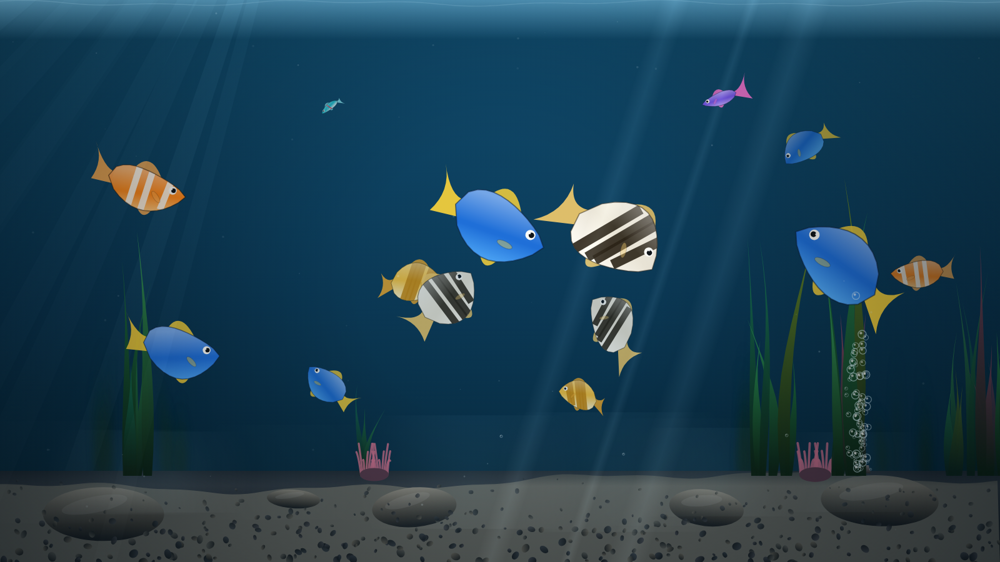

# Aquário — wallpaper animado

Recriação em HTML5 Canvas de um aquário tropical animado, para usar como papel de
parede vivo no computador. Inspirado nos live wallpapers de aquário do Android,
mas com arte e código 100% próprios — nenhum asset do app original foi usado.



Tudo é desenhado por código: peixes, plantas, cascalho, pedras, bolhas, raios de
luz e o reflexo do vidro. Sem imagens externas, sem dependências, sem rede.
São dois arquivos (`index.html` + `aquarium.js`) e funciona offline.

## O que tem

- **8 espécies de peixe** procedurais (palhaço, cirurgião, amarelo, anjo, cardeal,
  guppy, neon, borboleta), cada uma com corpo, faixas, nadadeiras e cauda próprios.
- **Natação com ondulação real** — o corpo curva ao longo da espinha e a cauda bate
  em contrafase, com aceleração e curvas suaves.
- **Profundidade**: peixes ao fundo ficam menores e por trás de uma névoa de água;
  os da frente passam por cima das plantas.
- **Toque/clique**: os peixes por perto nadam **até o ponto tocado** e ao mesmo tempo
  cai ração ali. Arrastando com o botão pressionado, o cardume acompanha o cursor.
- **Cenário vivo**: plantas balançando, anêmonas, cáusticas no cascalho, raios de
  luz oscilando, coluna de bolhas do difusor, partículas em suspensão.
- **3 ambientes**: Recife, Águas fundas, Lagoa.

## Como usar

### Só ver rodando

Abra o `index.html` no navegador e aperte F11 para tela cheia.

### Windows — Lively Wallpaper (recomendado, gratuito)

1. Instale o [Lively Wallpaper](https://www.rocksdanister.com/lively/) (Microsoft Store ou GitHub).
2. Na aba **Library**, clique em **+** → **Browse** e escolha o `index.html` desta pasta.
3. O Lively lê o `LivelyProperties.json` incluído aqui: clique no ícone de engrenagem
   do wallpaper e você regula peixes, velocidade, luz e cenário direto pela interface dele.

### Windows — Wallpaper Engine (pago, Steam)

Crie um wallpaper do tipo **Web** apontando para o `index.html`. O projeto já responde
ao `wallpaperPropertyListener`, então propriedades customizadas funcionam.

### macOS — Plash (gratuito)

1. Instale o [Plash](https://sindresorhus.com/plash) na Mac App Store.
2. **Add Website** → **Local File** → selecione o `index.html`.
3. Marque *Browsing Mode* desligado para o clique não interferir no desktop
   (ou deixe ligado se quiser poder alimentar os peixes).

### Linux

- **KDE Plasma**: clique com o botão direito na área de trabalho →
  *Configurar Área de Trabalho* → tipo de papel de parede **HTML** (plugin
  `plasma-wallpaper-html`), ou use o [Hidamari](https://github.com/jeffshee/hidamari)
  com a opção de página web.
- **GNOME / outros**: rode um navegador em modo quiosque atrás dos ícones, ex.:
  `chromium --app=file:///caminho/index.html --kiosk --window-position=0,0`
  combinado com `xwinwrap`.

## Controles

| Tecla / ação | Efeito |
|---|---|
| **clique** | os peixes vêm até o ponto e cai ração ali |
| **arrastar** | o cardume acompanha o cursor enquanto o botão fica pressionado |
| **F** | alimenta num ponto aleatório |
| **S** | abre/fecha o painel de ajustes |
| **Esc** | fecha o painel |

O painel fica escondido por padrão — um wallpaper não deve mostrar interface.

## Ajustes por URL

Útil quando o programa de wallpaper só aceita um endereço:

```
index.html?fishCount=22&theme=lagoon&speed=0.7&light=1.4&bubbles=0
```

| Parâmetro | Valores | Padrão |
|---|---|---|
| `fishCount` | 1 a 40 | `14` |
| `speed` | 0.2 a 2 | `1` |
| `light` | 0 a 2 | `1` |
| `theme` | `reef`, `deep`, `lagoon` | `reef` |
| `bubbles` | `0` / `1` | `1` |
| `plants` | `0` / `1` | `1` |
| `glass` | `0` / `1` | `1` |

## Desempenho

Roda em Canvas 2D, com DPR limitado a 2× e a animação **pausada quando a janela
não está visível** — sem consumo de CPU com o desktop coberto. Se quiser baixar
ainda mais o custo em notebook, reduza `fishCount` e desligue `glass`.

## Estrutura

```
index.html             página + painel de ajustes
aquarium.js            cena, peixes, partículas, luz e vidro
LivelyProperties.json  controles nativos do Lively Wallpaper
preview.png            captura de tela
```
